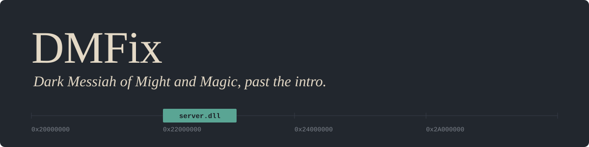
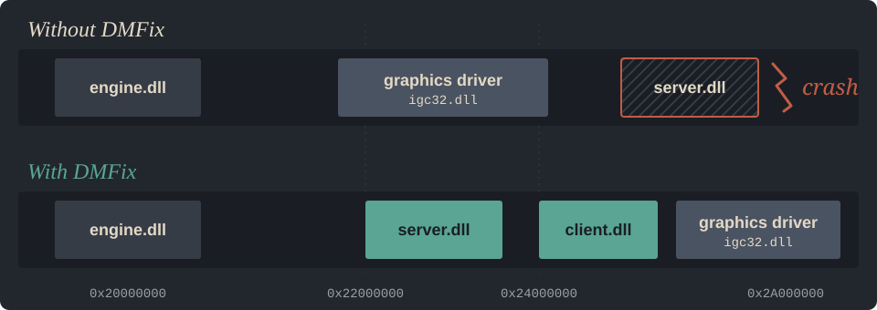

  

  
  
  
  

  <b>English</b> · <a href="#türkçe">Türkçe</a>

On today's PCs, Dark Messiah of Might and Magic often crashes the moment the intro ends.
**DMFix** is a small launcher that stops that crash and starts the game at your screen's
resolution with every setting at its highest. It contains no game files: you put it next to
your own install.

## Install

1. Download `DMFix.exe` and `DMFix_Setup.bat` from the [latest release](https://github.com/atmacafuat/dark-messiah-fix/releases/latest).
2. Put both in the game folder, next to `mm.exe`.
3. Run `DMFix_Setup.bat` once. It downloads about 8 MB (DXVK).
4. Play with `DMFix.exe` from now on. A desktop shortcut to it works too.

> Windows may say the publisher is unknown, because DMFix isn't code-signed.
> Choose **More info → Run anyway**. The whole program is one C file in this repository.

## What changes

| | |
|---|---|
| **No crash after the intro** | The game's own DLLs load at their own address. Nothing is injected into other programs, and `mm.exe` is left untouched. |
| **Vulkan through DXVK** | DirectX 9 is translated to Vulkan: steadier frame times and no crashes in old D3D9 drivers. The picture is the game's own; no filters are added. |
| **Every setting at its highest** | 8x MSAA, 16x anisotropic filtering, full HDR, parallax mapping, high effects, reflective water, VSync. Written where the engine actually reads them. |
| **Your screen, borderless** | Opens at your monitor's resolution in a borderless window, with the frame cap at its refresh rate. Intro videos are skipped. |
| **4 GB of memory** | The launcher is Large Address Aware, so the game can use 4 GB instead of 2. |
| **The right graphics card** | On laptops with two GPUs, Windows is told to use the fast one for the game. |

## Why it crashed

  

Every DLL has a preferred address. If that address is taken, Windows moves the DLL and uses
its relocation table to fix up every pointer inside it. In some builds of Dark Messiah,
`server.dll` and `client.dll` ship with an incomplete relocation table, so a moved
`server.dll` reads an address that was never fixed up and the game crashes
(`server.dll+0x158221`). Modern graphics drivers, Intel's in particular, often sit right at
`0x22000000`, which is where `server.dll` wants to be.

`mm.exe` does very little: it adds `bin\` to `PATH`, loads `bin\launcher.dll` and calls
`LauncherMain`. DMFix does the same, but first loads `server.dll` and `client.dll` into its
own process while their addresses are still free. When the engine asks for them later,
Windows hands back the copies that are already in place. The addresses are read from the
DLL headers; nothing is hard-coded.

The engine also keeps its video options in `HKCU\Software\Valve\Source\mm\Settings` and reads
them at startup, so `autoexec.cfg` can't raise them. Setup writes the highest values there.

## Options

- `--lang en|tr` sets the message language (default: your Windows language).
- Anything else is passed to the game, for example `DMFix.exe -w 2560 -h 1440` or `DMFix.exe +map l00`.

## Uninstall

Delete `DMFix.exe` and `d3d9.dll` (rename `d3d9.dll.bak` back if you had one), and
`mm/cfg/autoexec.cfg`. Change the video settings back in the game's options if you like.
Your saves aren't touched.

## Status

Tested on one PC: i7-11800H, RTX 3050 Ti Laptop with Intel UHD, Windows 11, 1080p 144 Hz,
retail build. If you try it on other hardware or the Steam version,
[open an issue](https://github.com/atmacafuat/dark-messiah-fix/issues) with your result,
good or bad. It needs 64-bit Windows 10/11 and a Vulkan-capable GPU (roughly 2016 or newer).

## Build

Visual Studio with the C++ workload: run `build.bat`. The output is `dist\DMFix.exe`.
One C file, Win32 API only, no dependencies.

## Credits

DMFix is an unofficial fan tool under the [MIT license](LICENSE). Dark Messiah of Might and
Magic belongs to its owners; you need your own copy. [DXVK](https://github.com/doitsujin/dxvk)
is by Philip Rebohle and contributors (zlib license) and is downloaded from its official release.

---

## Türkçe

Dark Messiah of Might and Magic bugünkü bilgisayarlarda çoğu zaman intro biter bitmez
çöküyor. **DMFix** bu çökmeyi durduran ve oyunu ekranının çözünürlüğünde, tüm ayarlar en
yüksekte açan küçük bir başlatıcı. Oyun dosyası içermez; kendi kurulumunun yanına konur.

**Kurulum**

1. `DMFix.exe` ve `DMFix_Setup.bat` dosyalarını [son sürümden](https://github.com/atmacafuat/dark-messiah-fix/releases/latest) indir.
2. İkisini de oyun klasörüne, `mm.exe`'nin yanına koy.
3. `DMFix_Setup.bat`'ı bir kez çalıştır. Yaklaşık 8 MB (DXVK) indirir.
4. Bundan sonra oyunu `DMFix.exe` ile aç.

Windows "bilinmeyen yayıncı" derse **Ek bilgi → Yine de çalıştır**'ı seç; DMFix imzalı değil.

**Neler değişiyor:** intro'dan sonra çökme yok, DXVK ile Vulkan (görüntüye filtre eklemez),
en yüksek grafik ayarları (8x MSAA, 16x AF, HDR, paralaks, yüksek efektler), ekranının
çözünürlüğünde kenarlıksız pencere, 4 GB bellek, laptoplarda hızlı ekran kartı.

**Neden çöküyordu:** `server.dll` sabit bir adreste (`0x22000000`) çalışmak üzere yapılmış ve
bazı sürümlerde başka bir adrese taşınınca bozuluyor. Modern ekran kartı sürücüleri tam o
adrese oturuyor. DMFix, oyunun kendi dosyalarını başka hiçbir şey araya girmeden yerine yerleştiriyor.

Mesajlar Windows diline göre Türkçe ya da İngilizce çıkar; `--lang tr` ile zorlanabilir.
Denediysen sonucunu bir [issue](https://github.com/atmacafuat/dark-messiah-fix/issues) olarak yaz.
